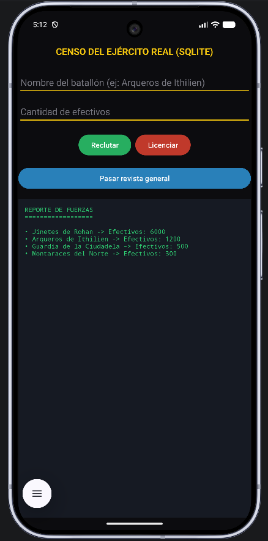

# Censo del Ejército Real

Aplicación Android que gestiona los batallones de un ejército con una base de datos SQLite local.

## Qué hace

- **Reclutar:** guarda un batallón con su número de efectivos. Si el nombre ya existe, actualiza los efectivos.
- **Licenciar:** borra un batallón por su nombre.
- **Pasar revista general:** muestra todos los batallones ordenados de mayor a menor número de efectivos.

## Base de datos

- Archivo: `ejercito.db`
- Tabla: `batallones`

| Columna  | Tipo    | Restricción |
|----------|---------|-------------|
| nombre   | TEXT    | PRIMARY KEY |
| soldados | INTEGER | NOT NULL    |

## Archivos principales

- `AdminSQLiteOpenHelper.kt`: crea la base de datos y la tabla (`SQLiteOpenHelper`).
- `MainActivity.kt`: botones y operaciones CRUD (`ContentValues`, `insertWithOnConflict`, `delete`, `rawQuery` y `Cursor`).
- `activity_main.xml`: pantalla con los campos, los botones y el listado.
- `AndroidManifest.xml`: registra la actividad principal.

## Detalles a tener en cuenta

- Los campos vacíos o un número no válido se controlan antes de usar la base de datos.
- El borrado usa un parámetro (`nombre = ?`) para evitar inyección SQL.
- El `Cursor` y la base de datos se cierran siempre dentro de un `try/finally`.

## Comprobar la base de datos

1. Ejecuta la app en el emulador.
2. Abre **App Inspection** en Android Studio.
3. Selecciona el proceso `com.isengard.censo_ejercito_real`.
4. En **Database Inspector**, abre `ejercito.db` y haz doble clic en la tabla `batallones`.

## Datos de prueba

| Batallón                | Efectivos |
|-------------------------|-----------|
| Jinetes de Rohan        | 6000      |
| Arqueros de Ithilien    | 1200      |
| Guardia de la Ciudadela | 500       |
| Montaraces del Norte    | 300       |

## Captura de la App

